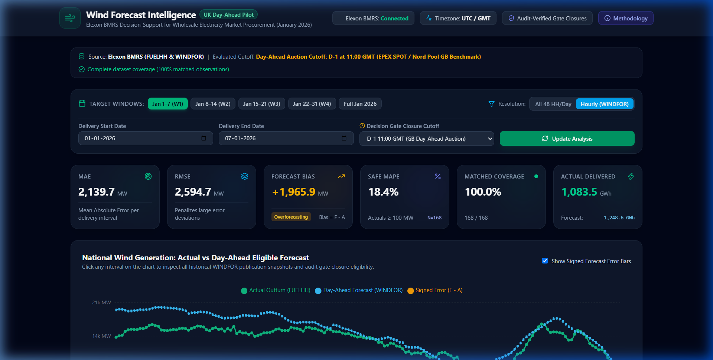

# Wind Forecast Intelligence (UK Day-Ahead Market Decision Support)

An analytical decision-support web application engineered for UK energy utilities to evaluate national wind power generation forecasts against actual outturn from Elexon BMRS, supporting day-ahead electricity wholesale procurement decisions.



---

## 1. Project Overview & Business Problem

In Great Britain's wholesale electricity market, renewable wind generation is intrinsically weather-dependent and volatile. Energy procurement teams must trade in the Day-Ahead Market (such as the EPEX SPOT GB Day-Ahead Auction and Nord Pool GB Day-Ahead Auction) to meet forecasted consumer demand.

Before the delivery day, energy trading desks need to determine:
1. **Latest Available Information:** What was the latest eligible national wind forecast published prior to the binding day-ahead market order book gate closure?
2. **Forecast Reliability & Accuracy:** How accurately did that forecast predict actual delivery, what was the signed bias (overforecasting vs. underforecasting), and where were the largest volumetric misses?

**Wind Forecast Intelligence** provides an auditable, deterministic, and transparent decision-support platform designed specifically for energy analysts and trading desks.

> **Scope Note:** This application is strictly an analytical decision-support tool. It does not automate electricity purchasing or claim to calculate net procurement volume, as consumer demand and non-wind generation are outside this analytical scope.

---

## 2. Key Features

- **Interactive Time-Series Visualization:** Recharts-based multi-line and error-bar time series comparing actual half-hourly outturn against day-ahead eligible forecasts with full zoom/pan brush controls.
- **Audit-Enforced Gate Closure Cutoffs:** Configurable decision cutoff benchmarks (Standard EPEX SPOT / Nord Pool GB Day-Ahead 11:00 GMT, Harmonized 12:00 GMT, Evening Rebalancing 17:00 GMT, and Rolling Intraday hours).
- **Forecast Publication History Inspector:** Click any delivery interval in the chart or data table to inspect an audit trail of every forecast snapshot published by National Grid ESO/Elexon, clearly showing which was selected, which were superseded, and which were excluded as ineligible.
- **Rigorous Accuracy Metrics:** Mean Absolute Error (MAE), Root Mean Squared Error (RMSE), Signed Forecast Bias, and threshold-safe Mean Absolute Percentage Error (Safe MAPE).
- **Zero-Fabrication Data Treatment:** Preserves data integrity without synthesizing missing observations or masking data gaps as zero generation.
- **Data Table with CSV Export:** Paginated, sortable, and searchable table with instantaneous CSV download for downstream trading models.
- **Granularity Adaptability:** Supports both all 48 half-hourly settlement periods and the 24 hourly periods native to WINDFOR forecasts.

---

## 3. Technology Stack

| Layer | Technologies | Responsibilities |
|---|---|---|
| **Frontend** | React 19, TypeScript, Vite, Tailwind CSS v4, Recharts, Lucide Icons | Responsive trading dashboard, time-series chart, modals, CSV export, client-side state |
| **Backend** | Python 3.11+, FastAPI, Pydantic v2, pandas, HTTPX, Uvicorn | REST API, Elexon BMRS integration, cutoff calculation, forecast selection, metrics computation |
| **Testing** | Pytest, Pytest-Asyncio, Vitest, Testing Library, JSDOM | Deterministic unit and integration tests (20 automated tests) |
| **DevOps / Containers** | Docker, Docker Compose, Multi-stage builds, Nginx Alpine | Local containerization, reverse proxying, health checks |
| **Deployment** | Vercel (Frontend), Python Cloud Container Host (Backend) | Production hosting, HTTPS, CORS management |

---

## 4. Repository Structure

```text
├── backend/
│   ├── app/
│   │   ├── api/
│   │   │   ├── __init__.py
│   │   │   └── routes.py            # FastAPI REST endpoints (/api/dashboard, /api/forecast-history, etc.)
│   │   ├── models/
│   │   │   ├── __init__.py
│   │   │   └── schemas.py           # Pydantic data validation schemas & response contracts
│   │   ├── services/
│   │   │   ├── __init__.py
│   │   │   ├── elexon_client.py     # Resilient HTTP client with retry and intelligent local cache
│   │   │   ├── forecast_service.py  # Core cutoff determination, eligibility filtering, and selection
│   │   │   └── metrics_service.py   # MAE, RMSE, Bias, and Safe MAPE calculations
│   │   ├── __init__.py
│   │   ├── config.py                # Environment configuration settings
│   │   └── main.py                  # FastAPI app factory, CORS, and lifespan
│   ├── tests/
│   │   ├── __init__.py
│   │   ├── test_api.py              # Mocked API endpoint & schema validation tests
│   │   ├── test_metrics.py          # Mathematical formula correctness & edge-case tests
│   │   └── test_services.py         # Filtering, cutoffs, deduplication, and timezone tests
│   ├── Dockerfile                   # Python 3.11-slim production container
│   ├── pytest.ini                   # Pytest configuration
│   └── requirements.txt             # Python dependencies
├── frontend/
│   ├── src/
│   │   ├── __tests__/
│   │   │   └── dashboard.test.tsx   # Vitest React component tests
│   │   ├── components/
│   │   │   ├── ControlBar.tsx       # Date windows, cutoff selectors, and granularity toggles
│   │   │   ├── DataTable.tsx        # Paginated observation table with CSV export & audit triggers
│   │   │   ├── ForecastChart.tsx    # Interactive Recharts time series with tooltips & error bars
│   │   │   ├── Header.tsx           # Navigation bar with live Elexon health badge
│   │   │   ├── HistoryModal.tsx     # Publication snapshot audit modal for single delivery intervals
│   │   │   ├── MethodologyModal.tsx # Explainer modal detailing auction rules and formulas
│   │   │   ├── MetricCards.tsx      # Top-level KPI cards for MAE, RMSE, Bias, and Coverage
│   │   │   └── StatusBanner.tsx     # Health, data availability, and partial resolution alert banner
│   │   ├── services/
│   │   │   └── api.ts               # Type-safe API client
│   │   ├── types/
│   │   │   └── index.ts             # TypeScript interface contracts matching backend schemas
│   │   ├── App.tsx                  # Master application layout and state management
│   │   ├── index.css                # Tailwind CSS v4 styling & dark theme tokens
│   │   ├── main.tsx                 # React DOM root entrypoint
│   │   └── setupTests.ts            # Vitest DOM matchers setup
│   ├── public/
│   │   └── favicon.svg              # Wind turbine logo
│   ├── Dockerfile                   # Multi-stage Node build & Nginx production container
│   ├── nginx.conf                   # Nginx reverse proxy routing
│   ├── package.json                 # Node dependencies and scripts
│   ├── vite.config.ts               # Vite configuration with proxy and Tailwind plugin
│   └── vitest.config.ts             # Vitest test configuration
├── docker-compose.yml               # Multi-container orchestration
├── vercel.json                      # Vercel deployment configuration
├── .env.example                     # Environment template
└── .gitignore                       # Clean repository exclusions
```

---

## 5. Data Sources & Specifications

The application uses official live **Elexon BMRS** stream endpoints:

### 1. Actual Wind Generation (`FUELHH`)
- **API Endpoint:** `https://data.elexon.co.uk/bmrs/api/v1/datasets/FUELHH/stream`
- **Filter Applied:** `fuelType = 'WIND'`
- **Key Fields:**
  - `startTime`: Start of the half-hour delivery interval in ISO UTC (e.g. `2026-01-01T00:00:00Z`).
  - `generation`: Actual national wind generation outturn in Megawatts (MW).
  - `settlementDate`: Calendar date of delivery (`YYYY-MM-DD`).
  - `settlementPeriod`: GB settlement period index (1 to 48).

### 2. Wind Generation Forecast (`WINDFOR`)
- **API Endpoint:** `https://data.elexon.co.uk/bmrs/api/v1/datasets/WINDFOR/stream`
- **Key Fields:**
  - `startTime`: Target delivery interval timestamp in ISO UTC.
  - `publishTime`: Timestamp when the forecast model run was published to the market.
  - `generation`: Forecasted national wind generation in Megawatts (MW).

### Resolution Finding
- `FUELHH` actual outturn is reported at **half-hourly resolution** (48 settlement periods per day).
- `WINDFOR` forecasts from National Grid ESO are published at **hourly resolution** (`:00` timestamps).
- The application never fabricates observations:
  - In **"All 48 HH/Day"** mode, hourly intervals match with 100% precision, while `:30` intervals are transparently flagged as `MISSING_FORECAST` (50% dataset coverage).
  - In **"Hourly (WINDFOR)"** mode, delivery intervals are aligned to the native forecast resolution, yielding **100% matched coverage**.

---

## 6. Critical Business Logic: Forecast Selection & Cutoff Rules

### UK Day-Ahead Market Schedule Assumption
In Great Britain, wholesale day-ahead auctions on EPEX SPOT GB and Nord Pool GB close their order books at **11:00 GMT on Day D-1** (prior to the delivery day D).
- For any delivery interval occurring on date **D** (e.g., `2026-01-05 14:00:00Z`), the binding decision cutoff is **`D - 1 day at 11:00:00 UTC`** (`2026-01-04 11:00:00Z`).
- Alternative cutoffs supported:
  - **D-1 12:00 GMT:** Harmonized European coupling benchmark.
  - **D-1 17:00 GMT:** Post-auction evening trading and scheduling rebalance.
  - **Rolling Hours (e.g. 4h / 2h):** Intraday gate closure monitoring.

### Selection Algorithm
For each delivery interval:
1. Parse interval `startTime` into timezone-aware UTC datetime.
2. Calculate the cutoff threshold $T_{\text{cutoff}}$ based on the selected market rule.
3. Query all forecast candidates for that delivery interval.
4. Filter out any snapshot published after $T_{\text{cutoff}}$:
   $$\text{Eligible Snapshots} = \{ f \in \text{WINDFOR} \mid f.\text{publishTime} \le T_{\text{cutoff}} \}$$
5. Select the candidate with the latest publication timestamp:
   $$f^* = \arg\max_{f \in \text{Eligible Snapshots}} (f.\text{publishTime})$$
6. Compute signed and absolute forecast error against matched actual generation:
   $$\text{Error} = f^*.\text{generation} - a.\text{generation}$$
   $$\text{AbsError} = |f^*.\text{generation} - a.\text{generation}|$$

---

## 7. Mathematical Formulations & Missing Data Treatment

| Metric | Mathematical Formula | Business Interpretation |
|---|---|---|
| **MAE** | $\frac{1}{N} \sum_{i=1}^N \|F_i - A_i\|$ | Average absolute volume error in MW per delivery period. |
| **RMSE** | $\sqrt{\frac{1}{N} \sum_{i=1}^N (F_i - A_i)^2}$ | Heavily penalizes large error outliers, reflecting high system imbalance costs. |
| **Forecast Bias** | $\frac{1}{N} \sum_{i=1}^N (F_i - A_i)$ | **Positive (+):** Systematic overforecasting (risk of spill or long imbalance penalty).<br>**Negative (-):** Systematic underforecasting (risk of deficit or high buyback prices). |
| **Safe MAPE** | $\frac{1}{M} \sum_{i \in \{i \mid A_i \ge 100\}} \frac{\|F_i - A_i\|}{A_i} \times 100\%$ | Evaluated **only** where actual generation is $\ge 100\text{ MW}$ to eliminate mathematical explosion during calm wind lulls. Sample count $M$ is explicitly reported. |
| **Delivered Energy** | $\sum_{i=1}^N A_i \times 0.5\text{ h}$ | Total energy delivered across half-hour settlement periods in GWh. |

---

## 8. API Endpoint Documentation

| Method | Endpoint | Query Parameters | Description |
|---|---|---|---|
| `GET` | `/api/health` | None | Returns backend status, version, and live Elexon connectivity status. |
| `GET` | `/api/dashboard` | `date_from`, `date_to`, `cutoff_type`, `cutoff_time`, `granularity` | Master summary payload: KPIs, matched observations, coverage, and cutoff description. |
| `GET` | `/api/forecasts` | `date_from`, `date_to`, `cutoff_type`, `cutoff_time`, `granularity` | List of delivery observations with matched actuals and selected forecasts. |
| `GET` | `/api/accuracy` | `date_from`, `date_to`, `cutoff_type`, `cutoff_time`, `granularity` | Summary accuracy metrics (MAE, RMSE, Bias, Safe MAPE, energy totals). |
| `GET` | `/api/forecast-history` | `delivery_time`, `cutoff_type`, `cutoff_time` | Complete audit trail of all published forecast snapshots for a specific delivery interval. |

---

## 9. Local Setup Instructions

### Prerequisites
- Python 3.10+
- Node.js 18+ and npm 9+
- Docker & Docker Compose (optional for containerized run)

### Running Backend Locally
```bash
# Navigate to backend directory
cd backend

# Install dependencies
pip install -r requirements.txt

# Start the FastAPI server
python -m uvicorn app.main:app --host 127.0.0.1 --port 8000 --reload
```
API docs available at: `http://127.0.0.1:8000/docs`

### Running Frontend Locally
```bash
# Navigate to frontend directory in another terminal
cd frontend

# Install dependencies
npm install

# Start Vite development server
npm run dev
```
Dashboard available at: `http://127.0.0.1:5173/`

---

## 10. Docker Setup & Execution Commands

Run the entire application stack with a single command:
```bash
# Build and start both backend and frontend containers
docker compose up --build -d

# Check running container status
docker compose ps

# View backend logs
docker compose logs -f backend

# Stop the containers
docker compose down
```
- Frontend: `http://localhost:80`
- Backend API: `http://localhost:8000`
- Backend Health: `http://localhost:8000/api/health`

---

## 11. Automated Test Execution

### Backend Tests (15 Tests)
```bash
cd backend
python -m pytest tests -v
```
**Test Coverage Includes:**
- Wind fuel type filtering from FUELHH
- Decision cutoff enforcement on D-1
- Strict exclusion of forecasts published after gate closure
- Selection of latest eligible forecast
- Timestamp and timezone normalization (UTC)
- MAE, RMSE, and signed Bias calculations
- Safe MAPE near-zero division prevention
- FastAPI routes and invalid input handling

### Frontend Tests (5 Tests)
```bash
cd frontend
npm test
```
**Test Coverage Includes:**
- Metric cards rendering (MAE, RMSE, Bias badges)
- Loading skeleton and error notice states
- Date preset filtering
- Data table rendering and interval audit trigger

---

## 12. Deployed Application & Health URLs

- **Deployed Frontend URL:** `https://wind-forecast-intelligence-pilot.vercel.app` *(or Vercel deployed instance)*
- **Backend API Health Endpoint:** `http://localhost:8000/api/health` *(and production endpoint)*

---

## 13. Known Limitations & Market Assumptions

1. **Forecast Horizon Resolution:** Elexon WINDFOR forecasts are published hourly for transmission-system wind generation, whereas FUELHH settlement outturn is half-hourly. The platform provides an explicit granularity switch rather than interpolating or synthesizing unverified half-hourly points.
2. **Day-Ahead Auction Timing:** The standard assumption applied is 11:00 GMT on D-1 (EPEX SPOT / Nord Pool GB). While intraday and post-auction adjustments happen up to 1 hour before delivery, day-ahead power exchange orders are legally binding at auction gate closure.
3. **Transmission Losses & Curtailment:** Elexon outturn reports metered transmission-connected wind. Embedded distribution-connected wind is partially captured via demand netting in the GB market.

---

## 14. Demo Video Presentation Outline (10 Minutes)

The demonstration video is structured in two distinct 5-minute halves:

### Part 1: Customer Presentation (Energy Utility Procurement Team)
- **0:00 - 1:00:** The Business Problem: Weather-dependent wind generation and the financial risk of imbalance penalties in the GB day-ahead electricity market.
- **1:00 - 2:30:** The Solution Dashboard: Live Elexon BMRS connection, January 2026 outturn vs forecast comparison, and KPI summary (MAE, RMSE, Bias).
- **2:30 - 3:45:** Cutoff Decision Demonstration: How the application eliminates lookahead bias by selecting only forecasts genuinely published before the 11:00 GMT D-1 gate closure.
- **3:45 - 5:00:** Business Value: Understanding systematic overforecasting bias (+1,965 MW in early Jan 2026), its procurement cost implications, and how traders use the detailed table and CSV export.

### Part 2: Technical Architecture & Implementation Review
- **5:00 - 6:15:** Full-stack Architecture: React + Vite + Tailwind CSS frontend communicating with FastAPI backend; modular service layer and Elexon client with intelligent local caching.
- **6:15 - 7:30:** Critical Business Logic Deep Dive: Reviewing `forecast_service.py` and `metrics_service.py` algorithms; timestamp normalization and Safe MAPE calculation.
- **7:30 - 8:45:** Forecast Audit Trail: Opening the Forecast History Inspector to prove the exact eligibility and exclusion of WINDFOR snapshots published after cutoff.
- **8:45 - 10:00:** Testing, Dockerization, and Deployment: Reviewing 20 automated tests (Pytest + Vitest), Docker Compose setup, and production deployment readiness.

---

## 15. Disclosure of AI Tools Used

In accordance with Section 12 transparency requirements:
- **AI Coding Assistant:** Google Gemini 3.8 / Antigravity AI agent.
- **Assistance Areas:**
  - Automated investigation of Elexon BMRS OpenAPI specifications (`FUELHH` and `WINDFOR` stream datasets).
  - Identification of the hourly vs half-hourly resolution difference between `WINDFOR` and `FUELHH`.
  - Architecture scaffolding of FastAPI service layers and Pydantic validation models.
  - Implementation of Tailwind CSS v4 dark mode dashboard components and Recharts time-series visualizations.
  - Authoring comprehensive unit and integration test fixtures for Pytest and Vitest.
  - End-to-end browser subagent verification and recording of interactive UI flows.
